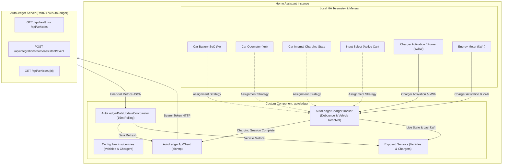

# AutoLedger - Home Assistant Integration

[](https://github.com/Rem7474/autoledger-homeassistant/actions/workflows/validate.yml)
[](https://github.com/Rem7474/autoledger-homeassistant/actions/workflows/tests.yml)
[](https://github.com/hacs/default)
[](https://opensource.org/licenses/MIT)

[Français](README.fr.md)

Official Home Assistant custom component integration for [AutoLedger](https://github.com/Rem7474/AutoLedger).

Connect your Home Assistant instance to AutoLedger to automatically detect EV charging sessions, calculate energy and financial analytics, handle dynamic solar anti-bounce interruptions, and view key vehicle metrics directly on your Lovelace dashboards.

---

## ⚡ Key Features

- **Every vehicle, automatically**: each vehicle the token can see is a Home Assistant device with its cost, reminder, consumption and data-gap entities. Nothing to add by hand; a vehicle created in AutoLedger appears on the next refresh.
- **Sending is optional and per vehicle**: link a vehicle only to send what Home Assistant knows about it (odometer, battery, trips, charges). Charging Stations / Energy Meters are configured independently: one residential charger can charge multiple cars.
- **Assisted HA Device Discovery**: Select your car device (Tesla, MG iSmart, Renault, OBD-II, etc.) to pre-fill telemetry entities.
- **Dedicated Charging Stations & Sub-meters**: Link wallboxes or energy monitors (Wallbox, Easee, Shelly Pro EM, Zaptec, etc.). Supports both **Total Increasing (cumulative kWh)** and **Session Energy** counter modes.
- **4 Vehicle Assignment Strategies**:
  1. **Fixed**: Permanently associate the charging station with a specific vehicle.
  2. **Dynamic Selector (input_select)**: Pick the currently connected car dynamically using a Home Assistant `input_select` or sensor entity.
  3. **Automatic Correlation**: Auto-match the active vehicle by detecting which car is currently reporting an internal charging state.
  4. **Unassigned / Multi-vehicle**: Send charge sessions with `vehicle_id: null` so they appear under *"Charges to Qualify"* in the AutoLedger web UI.
- **Dynamic Solar Anti-Bounce Debounce Engine**: EV charging on solar power frequently pauses due to passing clouds or household load shedding. The built-in configurable debounce timer (15s - 300s, default 60s) prevents fragmented micro-sessions by consolidating them into a single cohesive charging session.
- **Dedicated Vehicle & Charger Sensors**:
  - Vehicle: `sensor.<vehicle>_last_charge_cost`, `sensor.<vehicle>_cost_per_100km`
  - Charger: `sensor.<charger>_charging_state`, `sensor.<charger>_last_energy_kwh`, `sensor.<charger>_sync_status`
- **Maintenance and cost sensors** (token with the `homeassistant` scope; not created for an `ingest`-only token):
  - Vehicle: `sensor.<vehicle>_overdue_reminders`, `sensor.<vehicle>_reminders_due_soon` (the reminders are listed in the attributes), `sensor.<vehicle>_next_service_date`, `sensor.<vehicle>_next_service_distance`, `sensor.<vehicle>_cost_this_month` (with the split by category in the attributes), `sensor.<vehicle>_cost_per_km` (last 12 months), `sensor.<vehicle>_consumption` (kWh/100 km, electric and plug-in vehicles) and `sensor.<vehicle>_fuel_consumption` (L/100 km, fuel and plug-in vehicles); a figure AutoLedger cannot compute yet reads `unknown`, never 0
  - Vehicle, on by default: `sensor.<vehicle>_odometer` (the last reading AutoLedger holds) and `binary_sensor.<vehicle>_maintenance_overdue` (on while a reminder is past its limit; the overdue reminders are listed in the attributes)
  - Vehicle, created disabled (enable them from the entity settings): `sensor.<vehicle>_distance_this_month`, `sensor.<vehicle>_net_cost_this_month` (the month cost once the passengers of the carpools have paid, with the carpool revenue in the attributes), `sensor.<vehicle>_cost_last_12_months`, `sensor.<vehicle>_last_charge_price_per_kwh` (plug-in vehicles) and `sensor.<vehicle>_data_completeness` (diagnostic). They need an AutoLedger server that reports them and read `unknown` on an older one
  - Vehicle, created disabled, one group per section the server computes only when asked: tires (`sensor.<vehicle>_tire_wear`, `_tire_distance_left`, `_tire_replacement_date`), battery (`sensor.<vehicle>_battery_health`, plug-in vehicles), ownership (`sensor.<vehicle>_full_cost_per_km`, `_estimated_value`) and sources (`sensor.<vehicle>_last_record`, `_teslamate_last_sync`, diagnostic). The integration asks the server for a group only while one of its entities is enabled, so a disabled entity adds nothing to the server's work; enabling one reloads the integration. They read `unknown` on a server older than these sections
  - Account, electricity price of the default plan: `sensor.autoledger_electricity_price` (on by default, in the currency of the plan per kWh, with the plan name in the attributes), and created disabled `sensor.autoledger_electricity_band`, `sensor.autoledger_electricity_price_next_change` (a timestamp, unknown for a flat plan) and `sensor.autoledger_electricity_next_price`. The server holds the rules of the plan, so Home Assistant only reads the result; it reads the price again at the moment it changes, which makes "charge when it is cheap" automations possible. The price is read only while one of these entities is enabled
  - Vehicle diagnostic: `binary_sensor.<vehicle>_data_gaps` (on when records are missing that weaken the figures; attributes give the count and the completeness percentage)
  - Account: `sensor.autoledger_charges_to_qualify` (charging sessions pushed from Home Assistant that no vehicle claimed yet)
- **Native HA Services**:
  - `autoledger.sync`: Force an immediate synchronization with the AutoLedger server.
  - `autoledger.submit_charge`: Manually log or automate charging session submissions from HA scripts.
  - `autoledger.estimate_charge`: Price a charge at home with the plans of the account (returns the response).

---

## 🏗️ Architecture



---

## 📦 Installation

### Option 1: Via HACS (Recommended)

1. Ensure [HACS (Home Assistant Community Store)](https://hacs.xyz/) is installed.
2. In Home Assistant, open **HACS** > **Integrations**.
3. Click the three dots icon `⋮` in the top right corner and select **Custom repositories**.
4. Add the repository:
   - **Repository**: `https://github.com/Rem7474/autoledger-homeassistant`
   - **Type**: `Integration`
5. Click **Add**, locate **AutoLedger** in the integration list, and click **Download**.
6. Restart Home Assistant.

### Option 2: Manual Installation

1. Download the latest release `.zip` from GitHub.
2. Extract and copy the `custom_components/autoledger` directory into your Home Assistant `config/custom_components/` directory.
3. Restart Home Assistant.

---

## ⚙️ Configuration

### 1. Initial Connection (`ConfigEntry`)

1. In Home Assistant, navigate to **Settings** > **Devices & Services**.
2. Click **+ Add Integration** and search for **AutoLedger**.
3. Choose how to connect:
   - **Authorize in AutoLedger (recommended)**: enter the **Server URL**, then Home Assistant sends you to AutoLedger, where you sign in and approve the access. Tick the box that lets Home Assistant record charges, odometer readings and trips; without it the access is read-only: the figures are read, nothing is sent (no charge, odometer or trip tracking, no send buttons) and a repair issue explains how to authorize again. Nothing is copied by hand, the access renews itself, and you can end it from the API tokens list of your AutoLedger account. This needs OAuth enabled on the server (`AUTOLEDGER_MCP_ENABLED=true` or `AUTOLEDGER_OAUTH_ENABLED=true`) and an address AutoLedger can send you back to: [My Home Assistant](https://my.home-assistant.io/) (part of the default configuration) is used for that.
   - **Use an API token**: enter the **Server URL** and an API token created in *Account > API tokens* with the **`homeassistant`** scope (or `ingest`). A `read` or `write` token is refused at this step because it cannot send charges, odometer readings or trips.
   - **Verify SSL Certificate**: Enable or disable according to your local setup.
4. The integration validates the connection and the scope immediately. If AutoLedger later stops accepting the credentials (token revoked, authorization deleted or unused for 90 days), Home Assistant shows a **Re-authenticate** prompt on the integration card.

To move an existing token connection to OAuth, use **Reconfigure** on the integration card and choose **Authorize in AutoLedger**: vehicles, charging stations and entities are kept.

### 2. Send the data of a vehicle (🚗 subentries, optional)

Reading is automatic: every vehicle the token can see is a device with its entities as soon as the integration is connected. To hide one, disable its device in Home Assistant; to restrict what Home Assistant can read, limit the token to some vehicles in AutoLedger. A vehicle the server stops listing keeps its device, and its entities read `unavailable`.

Sending is configured per vehicle, because only you know which Home Assistant entity belongs to which car. The linked vehicles and the charging stations are listed on the integration card. Home Assistant 2025.3 or later is required.

1. On the AutoLedger integration card, click **Send the data of a vehicle**. To change or stop it later, use the ⋮ menu of its row (**Reconfigure** / **Delete**). Deleting it stops the sending; the vehicle stays in Home Assistant with its figures.
2. Pick the vehicle (the ones already linked are not offered).
3. Optionally select the associated Home Assistant Device to pre-fill entity fields.
4. Map vehicle telemetry entities:
   - **Battery State of Charge (%)**: Vehicle battery percentage sensor (optional).
   - **Vehicle Odometer (km)**: Vehicle distance sensor (optional). With it set, the vehicle device gets a **Send Odometer** button (pushes the current reading even when it has not advanced) and a **Last Odometer Sync** timestamp sensor.
   - **Vehicle Internal Charging Status Sensor**: Internal charging sensor (optional, used for correlation mode).
   - **Vehicle position for trips**: `device_tracker` or `person` entity (optional). Setting it enables trip tracking for this vehicle.
   - **Vehicle moving / engine on sensor for trips**: binary sensor (optional). When set, `on` opens a trip and `off` closes it after a short debounce. Without it, a trip opens when the position moves more than 100 m away from where the vehicle was parked (or the odometer increases) and closes after 5 minutes without movement.

### Trips

Each finished trip is sent to AutoLedger with its start/end time and position. The distance is never computed from GPS: it is the difference between the odometer readings at the start and end of the trip, and a trip without an odometer is recorded without a distance. When a point is inside a Home Assistant zone, the zone name is sent as the address; otherwise only the coordinates are sent (AutoLedger can resolve addresses if its reverse geocoding is enabled). Very short trips that end where they started are ignored, an unsent trip is retried every 5 minutes, and a trip in progress survives a Home Assistant restart.

### 3. Add charging stations (🔌 subentries)

1. On the AutoLedger integration card, click **Add charging station**.
2. **Step 1: Station Hardware & Settings**:
   - **Charging Station Name**: Friendly name (e.g. `Wallbox Garage`, `Smart Plug Patio`).
   - **Charging Status Sensor**: Binary sensor, switch, or power sensor (W or kW with > 500W threshold) that activates when charging begins.
   - **Charging Energy Sensor (kWh)**: Energy sensor from your wallbox or sub-meter.
   - **Energy Counter Mode**: `Total Increasing` (cumulative kWh) or `Session Energy` (resets per charge). Left empty, it is deduced from the sensor (`measurement` state class = per session).
   - **Solar Anti-Bounce Debounce (seconds)**: Delay timer before finalizing a session (15s - 300s, default: 60s).
   - **Default Location Tag**: Default location string sent to AutoLedger (default: `home`).
3. **Step 2: Vehicle Assignment Strategy**:
   - **Fixed**: Select any vehicle of your AutoLedger account; it does not have to be linked for sending first.
   - **Dynamic Selector (input_select)**: Select an `input_select` or sensor entity indicating the vehicle currently connected.
   - **Automatic Correlation**: Automatically assigns the session to whichever vehicle is charging simultaneously.
   - **Unassigned / Multi-vehicle**: Sends `vehicle_id: null` to qualify the charge later in AutoLedger.

---

## ☀️ Solar Anti-Bounce Debounce Explained

Charging electric vehicles with solar surplus (PV diversion) often involves temporary interruptions when clouds pass over solar arrays or household appliances (ovens, heat pumps) kick in.

Standard energy loggers often register multiple tiny sessions of a few minutes, cluttering logs and distorting statistics. AutoLedger solves this:

1. **Charge Started**: The charger enters charging state. Initial odometer, initial SoC, and initial energy counter reading are recorded.
2. **Temporary Pause / Cloud**: When charging drops to `idle` / `off` (or power falls below 500W), the debounce timer arms (e.g., 60 seconds) without closing the session. The status changes to `cooling_down`.
3. **Resumption**: If charging resumes before the timer expires, the timer is aborted and the session continues seamlessly.
4. **Completion**: If the timer expires, the total energy added (`energy_final - energy_start`), final SoC, and vehicle assignment are resolved and transmitted to AutoLedger in a single event.

## 💾 Restarts & Offline Server

- A running session is saved as it progresses. After a Home Assistant restart it resumes (charger still charging) or is finalized (charger stopped meanwhile).
- When AutoLedger cannot be reached (network error, timeout, HTTP 5xx/408/429), the session is kept in a persisted queue and resent every 5 minutes and at startup. Each event carries a stable `event_id`, so a resent session is never duplicated. Up to 100 sessions are kept per charger.
- A session AutoLedger refuses with another 4xx error is not retried.

---

## 📊 Exposed Sensors

### Vehicle Entities
The main figures are enabled: cost this month, cost per km, consumption, next service date, data gaps, last charge cost and cost per 100 km. The secondary ones (`overdue_reminders`, `reminders_due_soon`, `next_service_distance`) are created disabled so a large fleet does not flood the entity list; enable them from the entity settings. The last charge cost is created for vehicles that can be plugged in.

| Sensor Entity ID | Device Class | Unit | Description |
|---|---|---|---|
| `sensor.<vehicle>_last_charge_cost` | `monetary` | `€` / `$` | Total financial cost of the last charging session. |
| `sensor.<vehicle>_cost_per_100km` | - | `€/100km` | Smoothed average operating energy cost per 100 km calculated by AutoLedger. |
| `sensor.<vehicle>_cost_per_km` | - | `€/km` | What a kilometre cost over the last 12 months, all categories (`unknown` while the distance is unknown). |
| `sensor.<vehicle>_consumption` | - | `kWh/100 km` | Electric energy used per 100 km. |
| `sensor.<vehicle>_fuel_consumption` | - | `L/100 km` | Fuel used per 100 km between full tanks. |
| `binary_sensor.<vehicle>_data_gaps` | - | - | On when the records lack something that weakens the figures. |
| `sensor.<vehicle>_last_trip` | `timestamp` | - | End of the last trip sent (only with a trip position entity). Attributes: start time, addresses, coordinates, odometer readings. |

### Charging Station Entities
| Sensor Entity ID | Device Class | Unit | Description |
|---|---|---|---|
| `sensor.<charger>_charging_state` | - | - | Real-time state: `idle`, `charging`, or `cooling_down` (debouncing). |
| `sensor.<charger>_last_energy_kwh` | `energy` | `kWh` | Energy delivered during the last completed charging session. |
| `sensor.<charger>_sync_status` | - | - | Synchronization status: `ok`, `pending`, or `error`. |

---

## 🛠️ Home Assistant Services

### Service `autoledger.sync`
Force an immediate metrics refresh from your AutoLedger backend.

```yaml
action: autoledger.sync
data:
  entry_id: "optional_config_entry_id"
```

### Service `autoledger.log_trip`

Logs a trip by hand: `vehicle_id`, `start_time` and `end_time` are required; start/end latitude and longitude, addresses and start/end odometer (km) are optional. The distance is the odometer difference; without odometer values the trip has no distance.

### Action `autoledger.estimate_charge`

Prices a charge at home with the electricity plans of the AutoLedger account and returns the cost, the plan used and the bands the energy was split between. `energy_kwh` and `duration_minutes` are required; `start` (now by default) and `vehicle_id` (the plan assigned to that vehicle, else the default plan) are optional. Nothing is recorded. The action returns a response, so use it with `response_variable`:

```yaml
action: autoledger.estimate_charge
data:
  energy_kwh: 32.5
  duration_minutes: 240
response_variable: estimate
```

### Service `autoledger.submit_charge`
Manually push a charging session or trigger submissions via external automations / NFC tags.

```yaml
action: autoledger.submit_charge
data:
  vehicle_id: "c1f7a4b0-9b3e-4b2a-8921-729c4ef76a01"
  energy_kwh: 32.45
  cost: 7.50
  odometer_km: 45120
  soc_start: 20
  soc_end: 80
  location: "home"   # optional
```

---

## 🎨 Lovelace Dashboard Examples

### Example: Vehicle Summary Card (Mushroom Cards)

```yaml
type: vertical-stack
cards:
  - type: custom:mushroom-title-card
    title: Tesla Model Y
    subtitle: AutoLedger Financial & Energy Tracking

  - type: horizontal-stack
    cards:
      - type: custom:mushroom-entity-card
        entity: sensor.tesla_model_y_last_charge_cost
        name: Last Charge
        icon: mdi:ev-station
        icon_color: green

      - type: custom:mushroom-entity-card
        entity: sensor.tesla_model_y_cost_per_100km
        name: Cost / 100km
        icon: mdi:cash-multiple
        icon_color: blue

  - type: custom:mushroom-entity-card
    entity: sensor.tesla_model_y_charging_state
    name: State
    icon: mdi:lightning-bolt
```

### Example: Standard Entities Card

```yaml
type: entities
title: AutoLedger EV Status
entities:
  - entity: sensor.tesla_model_y_charging_state
    name: Charging State
  - entity: sensor.tesla_model_y_last_charge_cost
    name: Last Session Cost
  - entity: sensor.tesla_model_y_cost_per_100km
    name: Average Cost / 100km
  - entity: sensor.tesla_model_y_sync_status
    name: Sync Status
```

---

## 🧪 Testing & Validation

The codebase includes an automated unit test suite with high coverage:

```bash
# Run tests
pytest
```

---

## 📄 License

This project is licensed under the MIT License - see the [LICENSE](LICENSE) file for details.

## ⬆️ Upgrading

### From 2.0 to 2.1

Every vehicle the token sees becomes a device with its read entities, including the vehicles that had not been added. Existing entities keep their ids and history. The three secondary sensors above are created disabled for the new vehicles only: the ones already registered keep their state. The vehicle entry of the integration card only controls what Home Assistant sends; nothing has to be migrated. The figures of all vehicles come from one call to the AutoLedger summary (a server that predates it is read vehicle by vehicle).

### From 1.x

Version 2 stores vehicles and charging stations as Home Assistant *subentries* instead of options. The upgrade runs by itself the first time Home Assistant starts with the new version: every vehicle and charging station keeps its settings, its entities keep their ids and history, and a session in progress is resumed. A vehicle with a charging status sensor and no charging station, which version 1 charged on its own, becomes an explicit charging station with the same name. Take a Home Assistant backup before upgrading: an entry migrated to version 2 cannot be opened by version 1 again.
